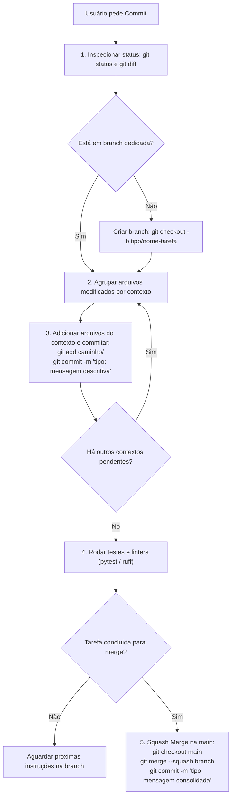

# semantic-commit-workflow

> **Padrão de Versionamento Git e Fluxo de Commits Semânticos**
> Este guia estabelece o procedimento operacional padrão para criação de branches, elaboração de commits semânticos por contexto de arquivos e integração controlada na branch principal (`main`).

---

## 🎯 Regras de Ouro do Fluxo Git

1. **Nunca comite código quebrado diretamente na `main`**:
   - Cada funcionalidade, documentação ou refatoração deve ser desenvolvida em uma **branch dedicada** com nome contextual (ex: `feat/nome-da-feature`, `docs/nome-do-guia`, `refactor/nome-do-modulo`).
2. **Commits Semânticos e Granulares na Branch**:
   - Faça commits separados por **contexto de arquivos** (ex: commit exclusivo para documentação, commit exclusivo para contratos de API, commit exclusivo para diagramas).
3. **Validação Obrigatória Pré-Merge**:
   - Antes de integrar à branch principal, certifique-se de que a suíte de testes (`pytest`) e as ferramentas de linting (`ruff`) passam com 100% de sucesso.
4. **Integração via Squash Merge Local**:
   - Ao concluir a tarefa, retorne à branch `main` e realize o merge com squash:
     ```bash
     git checkout main
     git merge --squash <nome-da-branch>
     git commit -m "<tipo>(<escopo>): <mensagem consolidada>"
     ```
5. **Push Apenas sob Ordem Explícita**:
   - Mantenha tudo no repositório **local**. **NUNCA** execute `git push` para o repositório remoto a menos que o usuário solicite explicitamente ao final da sessão.

---

## 🏷️ Estrutura do Conventional Commit

Cada mensagem de commit deve seguir rigorosamente a especificação do [Conventional Commits](https://www.conventionalcommits.org/):

```text
<tipo>(<escopo opcional>): <descrição no imperativo, em minúsculas e sem ponto final>

[corpo opcional explicando o porquê da mudança]

[rodapé opcional com referências ou breaking changes]
```

### Tipos Permitidos:

| Tipo | Quando Utilizar | Exemplo |
| :--- | :--- | :--- |
| **`feat`** | Nova funcionalidade ou novo endpoint de API | `feat(crypto): adicionar suporte a chave derivacao HKDF` |
| **`fix`** | Correção de bug ou falha de comportamento | `fix(auth): corrigir validacao de tag GCM no login` |
| **`docs`** | Criação ou atualização de documentação, README, slides ou diagramas | `docs(slides): adicionar deck de apresentacao em slidev` |
| **`refactor`** | Alteração no código que não muda comportamento externo nem corrige bug | `refactor(services): extrair normalizacao de blind index para metodo puro` |
| **`test`** | Adição ou correção de testes automatizados | `test(api): adicionar testes de integracao para busca por CPF` |
| **`style`** | Ajustes de formatação, espaços, lint (sem alteração de lógica) | `style(core): formatar imports com ruff` |
| **`build`** | Mudanças em dependências, `pyproject.toml`, `package.json`, Docker | `build(deps): adicionar dependencias do slidev` |
| **`ci`** | Ajustes em scripts de CI/CD, pipelines e GitHub Actions | `ci(test): configurar execucao automatica de testes` |
| **`chore`** | Tarefas de manutenção rotineira que não tocam código de produção | `chore(clean): remover artefatos temporarios` |

---

## 🔄 Fluxo de Trabalho Passo a Passo

Sempre que o usuário pedir para fazer commit ou salvar alterações:



---

## 💻 Checklist de Comandos Operacionais

### 1. Iniciar Trabalho em Branch Nova
```bash
git checkout -b feat/nova-feature
# ou: docs/novos-diagramas
```

### 2. Commits Granulares por Contexto
```bash
# Contexto 1: Apenas documentação
git add docs/README.md docs/slides/
git commit -m "docs(slides): adicionar apresentacao interativa em slidev"

# Contexto 2: Apenas código core
git add src/app/core/crypto.py
git commit -m "feat(crypto): implementar suporte a validacao de AAD"
```

### 3. Validação de Integridade
```bash
# Executa testes unitários e de integração
.venv/bin/pytest -q

# Verifica formatação e boas práticas
.venv/bin/ruff check src tests scripts
```

### 4. Squash Merge Consolidado na `main`
```bash
git checkout main
git merge --squash feat/nova-feature
git commit -m "feat: implementar suporte completo a validacao de AAD e testes"
```

> [!IMPORTANT]
> **Nunca execute `git push` automaticamente.** Aguarde sempre a solicitação explícita do usuário para enviar as alterações ao repositório remoto.
