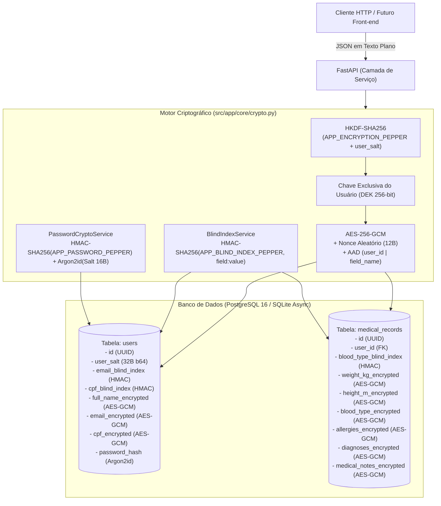

<div align="center">

# 🔐 MedVault Crypto API

**Demonstração Prática de Criptografia de Dados Sensíveis (PII & Prontuários Médicos) no Banco de Dados**

[](https://www.python.org/)
[](https://fastapi.tiangolo.com/)
[](https://www.sqlalchemy.org/)
[](https://cryptography.io/)
[](https://argon2-cffi.readthedocs.io/)
[](./docker-compose.yml)
[](https://docs.astral.sh/ruff/)
[](./LICENSE)

*Como garantir que dois pacientes com exatamente **`80.0 kg`** e sangue **`O+`** tenham valores **100% diferentes** no banco de dados, continuem **descriptografáveis pela API**, suportem **busca exata em O(1)** e sejam **imunes a adulteração**.*

[Documentação One-Pager](./docs/one-pager.md) • [Guia Didático](./docs/guia-didatico-criptografia.md) • [Slides da Apresentação](./docs/apresentacao-slides.md) • [PRD](./docs/prd.md) • [ADRs](./docs/adr/) • [Guia para IA (AGENTS.md)](./AGENTS.md)

</div>

---

## 🎯 O Desafio: "Hash + Salt + Pepper" vs Criptografia de Dados

Uma dúvida muito comum ao projetar segurança de banco de dados é: *"Posso usar **Hash + Salt + Pepper** para proteger campos como peso (`80.0 kg`), CPF ou diagnóstico médico?"*

A resposta técnica é que **cada categoria de dado exige uma primitiva criptográfica específica**:

| Necessidade no Sistema | Primitiva Correta | Como implementamos neste projeto |
| :--- | :--- | :--- |
| **1. Ler o dado de volta na API, mas garantir que valores iguais (`80.0 kg`) fiquem diferentes no banco** | **KDF (Salt + Pepper) + Criptografia Autenticada Probabilística (AEAD)** | **`HKDF-SHA256(ServerPepper + UserSalt)` + `AES-256-GCM` com Nonce aleatório de 96 bits + `AAD` (`user_id` + `field_name`)**. É reversível pela API, mas gera textos cifrados 100% diferentes para cada usuário e a cada gravação. |
| **2. Buscar por igualdade (`WHERE cpf = ?` ou `WHERE blood_type = 'O+'`) sem descriptografar a tabela inteira** | **Blind Index (Índice Cego com HMAC + Pepper)** | **`HMAC-SHA256(BlindIndexPepper, field:normalized_value)`**. Salvo em coluna indexada (`*_blind_index`), permitindo busca exata em $O(1)$ sem revelar o dado real. |
| **3. Validar senhas sem que ninguém (nem a API) consiga descobrir a senha original** | **Hash Irreversível + Salt + Pepper** | **`HMAC-SHA256(PasswordPepper, senha)` + `Argon2id` com Salt aleatório de 16 bytes**. Totalmente irreversível (mão única). |

---

## 🏗️ Arquitetura Criptográfica Visual



### Exemplo Real: O que fica salvo no Banco para `weight_kg = 80.0`?

Quando **Alice** e **Bruno** cadastram exatamente o mesmo peso (`80.0 kg`), o banco de dados armazena:

| Paciente | Valor Real (API) | Chave Derivada (HKDF Fingerprint) | Valor Bruto Salvo na Coluna `weight_kg_encrypted` no Banco |
| :--- | :---: | :---: | :--- |
| **Alice** | `80.0` | `sha256:4a9c18f0...3d12e8a1` | `v1$r8mK9pL2xQ1vZ0wN$7fG3kP9mW2xL8qR4tY6uI1oP3aS5dF7gH9jK...` |
| **Bruno** | `80.0` | `sha256:9b2e77c4...8f01a4c9` | `v1$bN4mV6cX8zL0kJ2h$1qW3eR5tY7uI9oP0aS2dF4gH6jK8lZ9xC1vB...` |

> [!IMPORTANT]
> **Proteção contra Transplante / Adulteração (AEAD + AAD)**: Se um invasor com acesso direto ao banco copiar o texto cifrado do peso da **Alice** e colar na coluna `weight_kg_encrypted` do **Bruno** (ou na coluna `height_m_encrypted` da própria Alice), a descriptografia falha instantaneamente com `CryptoIntegrityError (InvalidTag)`, pois tanto a chave derivada (HKDF) quanto os metadados autenticados (`AAD = user:<id>|field:<name>`) não conferem!

---

## 🚀 Como Executar o Projeto

### Opção 1: Com Docker e Docker Compose (PostgreSQL 16 + API)

```bash
# Sobe o PostgreSQL 16, aplica as migrações Alembic e inicia a API na porta 8000
bash scripts/up.sh

# Para ver os logs dos containers
bash scripts/logs.sh

# Para derrubar os serviços
bash scripts/down.sh
```

### Opção 2: Execução Local Rápida (Ambiente Virtual Python)

```bash
# 1. Cria a .venv, instala dependências e gera o .env
bash scripts/setup.sh

# 2. Roda a demonstração completa via CLI (2 pacientes com 80.0 kg + Tamper Check)
bash scripts/demo-scenario.sh

# 3. Inicia o servidor FastAPI com hot-reload em http://localhost:8000
bash scripts/dev.sh
```

Acesse a documentação interativa **Swagger UI** em: **`http://localhost:8000/docs`**

---

## 🔬 Endpoints da API (`/api/v1`)

### 1. Demonstração e Auditoria Criptográfica (`/api/v1/demo`)
Pensados especialmente para apresentações técnicas e para o futuro Front-end:

- **`POST /api/v1/demo/seed-comparison`**: Cria/recupera dois pacientes (*Alice* e *Bruno*) com **dados médicos 100% idênticos** (`80.0 kg`, `1.75 m`, `O+`, mesmas alergias/diagnósticos e mesma senha) e retorna o comparativo lado a lado provando que todas as colunas no banco são diferentes.
- **`GET /api/v1/demo/inspect-user/{user_id}`**: Exibe a radiografia completa de um usuário (valor em texto plano vs valor bruto no banco, nonce em hex/base64, tag de autenticação GCM, contexto AAD, salt do usuário, blind indexes HMAC e decomposição do hash Argon2id).
- **`POST /api/v1/demo/tamper-check`**: Simula 3 ataques reais no banco de dados (copiar ciphertext entre usuários, trocar ciphertext de coluna e alterar 1 byte do payload cifrado) e comprova o bloqueio pelo AES-256-GCM + HKDF + AAD.
- **`POST /api/v1/demo/crypto-playground`**: Playground interativo onde você envia qualquer valor (ex: `"80.0"`) e vê em tempo real as chaves derivadas, nonces, ciphertexts, blind indexes e hashes gerados.

### 2. Usuários & Busca Cega (`/api/v1/users`)
- **`POST /api/v1/users`**: Cria usuário criptografando PII (`full_name`, `email`, `cpf`), gerando hash `Argon2id` da senha e criptografando o prontuário médico opcional.
- **`GET /api/v1/users`**: Lista usuários descriptografados.
- **`GET /api/v1/users/search/by-cpf?cpf=123.456.789-01`**: Busca exata em $O(1)$ via `cpf_blind_index` (HMAC-SHA256).
- **`GET /api/v1/users/search/by-email?email=...`**: Busca exata em $O(1)$ via `email_blind_index` (HMAC-SHA256).
- **`GET /api/v1/users/{user_id}`** e **`DELETE /api/v1/users/{user_id}`**.

### 3. Prontuários Médicos (`/api/v1/medical-records`)
- **`PUT /api/v1/medical-records/user/{user_id}`**: Cria ou substitui o prontuário médico criptografado.
- **`PATCH /api/v1/medical-records/user/{user_id}`**: Atualiza parcialmente campos do prontuário gerando novos nonces.
- **`GET /api/v1/medical-records/user/{user_id}`**: Retorna o prontuário descriptografado com cálculo automático de IMC (`bmi`).
- **`GET /api/v1/medical-records/search/by-blood-type?blood_type=O+`**: Busca pacientes por tipo sanguíneo via `blood_type_blind_index` sem descriptografar os demais registros do banco.

### 4. Autenticação & Verificação Argon2id (`/api/v1/auth`)
- **`POST /api/v1/auth/login`**: Valida e-mail (via Blind Index) e senha (via Argon2id + Pepper), emitindo um Bearer Token JWT.
- **`POST /api/v1/auth/verify-password`**: Verifica uma senha e retorna a decomposição didática da string PHC do Argon2id (`$argon2id$v=19$m=19456,t=2,p=2$<salt>$<hash>`).
- **`GET /api/v1/auth/me`**: Retorna os dados descriptografados do usuário autenticado via JWT.

---

## 🧪 Testes Automatizados e Qualidade de Código

```bash
# Executar suíte completa de testes (Unitários + Integração) com relatório de cobertura
bash scripts/test.sh

# Verificar linting e formatação (Ruff)
bash scripts/lint.sh

# Formatar código automaticamente
bash scripts/format.sh
```

---

## 📚 Documentação de Arquitetura e Produto

| Documento | Descrição |
| :--- | :--- |
| [**Guia Didático Completo**](./docs/guia-didatico-criptografia.md) | Explicação passo a passo com analogias, glossário visual, Matriz de Ameaças (Threat Model) e roteiro de Live Demo. |
| [**Slides da Apresentação (Marp/Markdown)**](./docs/apresentacao-slides.md) | Apresentação de 11 slides pronta para aulas, palestras e demonstrações técnicas. |
| [**One-Pager Executivo**](./docs/one-pager.md) | Resumo de 1 página do problema, solução em 3 pilares e prova visual. |
| [**PRD (Product Requirements Document)**](./docs/prd.md) | Personas, requisitos funcionais (RF), requisitos não-funcionais (RNF) e escopo. |
| [**ADR 0001 — Clean Layered Architecture**](./docs/adr/0001-clean-layered-architecture.md) | Decisão sobre separação de camadas (`core`, `models`, `schemas`, `repositories`, `services`, `api`). |
| [**ADR 0002 — HKDF por Usuário + AES-256-GCM + AAD**](./docs/adr/0002-per-user-hkdf-and-aes-256-gcm.md) | Por que Hash não serve para dados reversíveis e como usamos Salt+Pepper no HKDF somado ao AES-256-GCM. |
| [**ADR 0003 — Blind Index com HMAC-SHA256**](./docs/adr/0003-hmac-blind-indexes-for-searchable-encryption.md) | Como realizar buscas exatas ($O(1)$) em colunas criptografadas. |
| [**ADR 0004 — Argon2id + Salt + Pepper para Senhas**](./docs/adr/0004-argon2id-with-pepper-for-passwords.md) | Arquitetura de hash irreversível de senhas resistente a GPUs/ASICs e vazamento de banco. |
| [**AGENTS.md**](./AGENTS.md) | Manual completo para Agentes de IA / LLMs operarem o projeto e seus scripts. |

---

## 📄 Licença

Distribuído sob a licença **MIT**. Veja [`LICENSE`](./LICENSE) para mais informações.
