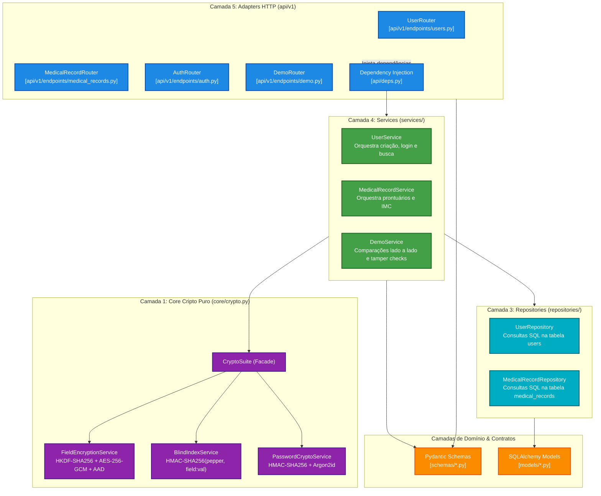

# Diagrama C4: Nível 3 — Componentes

> **Decomposição interna do container `medvault-api` mostrando Clean Architecture e Clean Code.**

Este diagrama detalha a estrutura interna de componentes dentro do backend seguindo o modelo C4 (Nível 3).

---

### O que este nível explica:
1. **Adapters HTTP**: Recebem requisições REST e validam payloads via Schemas Pydantic.
2. **Services**: Contêm a lógica de negócio e coordenam a criptografia e persistência.
3. **Core Crypto**: Módulo agnóstico e independente que executa o trabalho matemático pesado.
4. **Repositories**: Isolam a linguagem SQL e o ORM do restante da aplicação.
