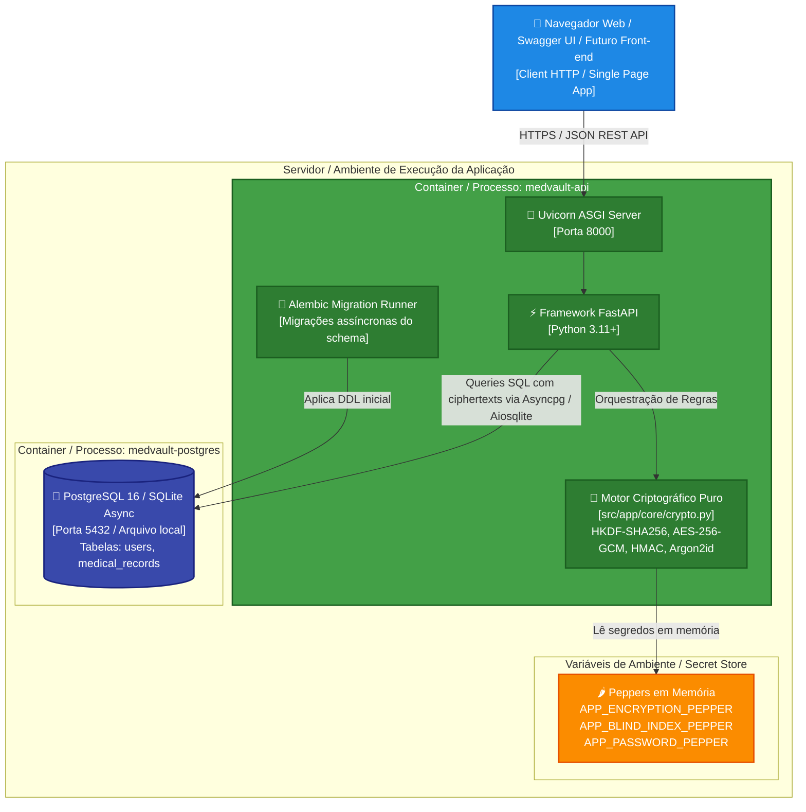

# Diagrama C4: Nível 2 — Containers

> **Visão dos subsistemas executáveis, tecnologias, protocolos de rede e armazenamento de dados.**

Este diagrama descreve a arquitetura de containers do MedVault Crypto API utilizando o modelo C4 (Nível 2).

---

### O que este nível explica:
1. **Frontend / Swagger** comunica-se via JSON HTTP com o servidor Uvicorn.
2. O **Motor Criptográfico** é executado dentro do processo da API Python, consumindo diretamente as bibliotecas `cryptography` e `argon2-cffi`.
3. Os **Peppers** residem estritamente na memória do processo da aplicação (`pydantic-settings`).
4. O **Banco de Dados** recebe apenas dados cifrados e os índices cegos gerados pelo motor antes do envio via SQLAlchemy Async.
