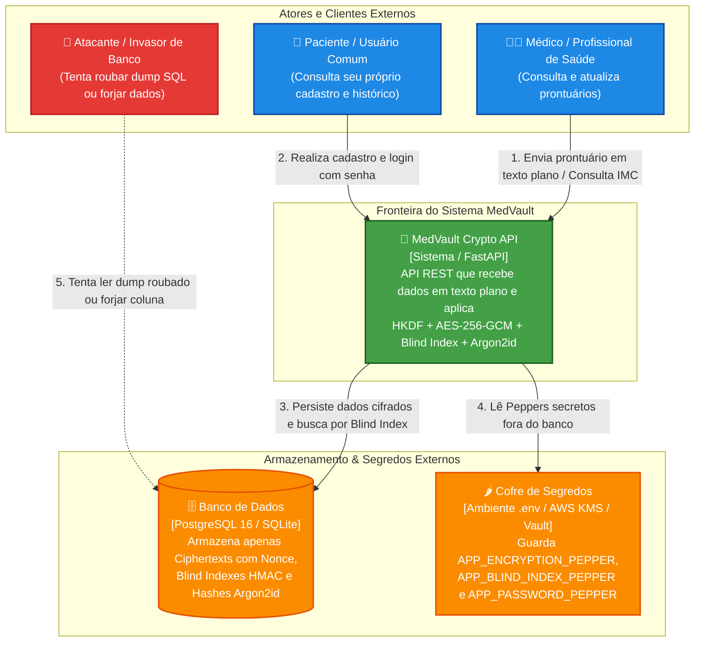

# Diagrama C4: Nível 1 — Contexto de Sistema

> **Visão geral de alto nível dos usuários, atores externos e fronteiras do sistema MedVault Crypto API.**

Este diagrama segue o modelo C4 (Nível 1 - Contexto) utilizando a sintaxe nativa e robusta de grafos do Mermaid (`flowchart TB`).

---

### O que este nível explica:
1. **O Médico e o Paciente** interagem com a API fornecendo dados normais em texto plano (`80.0 kg`, `O+`, `Dipirona`).
2. **A API MedVault** atua como o guardião criptográfico: transforma o dado antes de salvar e descriptografa ao responder.
3. **O Banco de Dados** nunca enxerga o dado original. Mesmo que o **Invasor** obtenha acesso irrestrito ao banco de dados, ele só encontra ruído aleatório incompreensível, pois os **Peppers** estão salvos exclusivamente no cofre do servidor.
