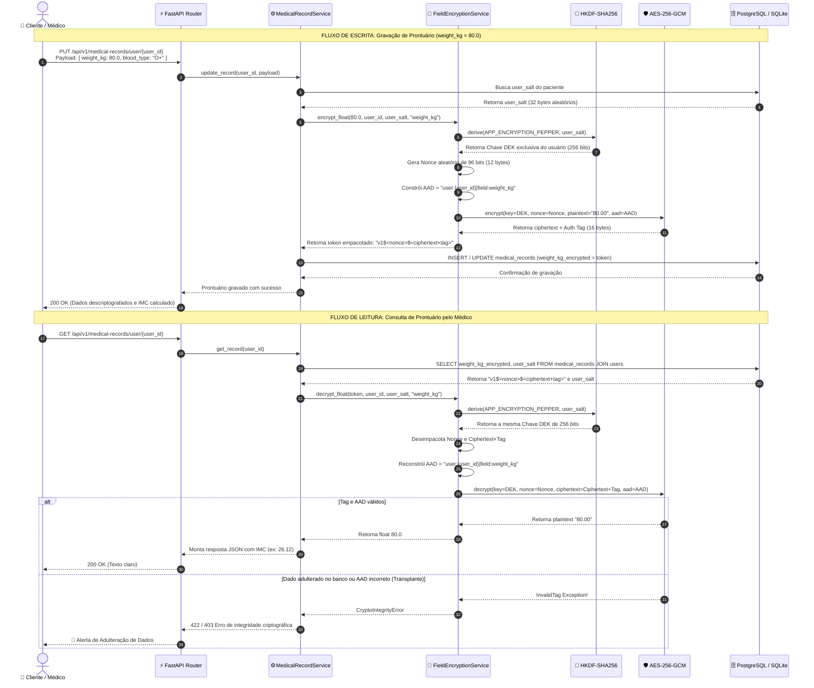

# Diagrama de Sequência: Ciclo de Vida da Criptografia (Escrita e Leitura)

> **Fluxo passo a passo demonstrando a cifragem com HKDF + AES-256-GCM + AAD na gravação e a validação de integridade na leitura.**

