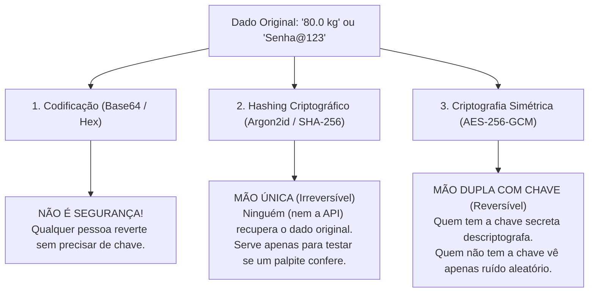

# Guia Didático Completo: Criptografia de Dados no Banco de Dados

> **Material de referência para estudos, aulas, palestras e treinamentos de engenharia de segurança utilizando o MedVault Crypto API.**

---

## 🧭 Introdução: Por que proteger o Banco de Dados?

Em qualquer aplicação conectada à internet, adota-se comumente a proteção da conexão via **HTTPS / TLS 1.3** (criptografia em trânsito). No entanto, o que acontece quando os dados chegam ao servidor e são salvos no banco de dados?

Se os dados forem armazenados em **texto plano (plaintext)**:
1. **Vazamento de Backups**: Um arquivo `.sql.gz` esquecido em um bucket S3 expõe todos os pacientes.
2. **Acesso Indevido de Administradores (DBA) ou Suporte**: Funcionários com credencial de leitura conseguem ler diagnósticos, salários ou CPFs.
3. **Invasão do Servidor de Banco**: Um atacante que explore uma falha no PostgreSQL tem acesso imediato a todas as tabelas.

---

## 1. Nível 1: A Grande Confusão (Codificação vs. Hash vs. Criptografia)

Antes de falar em *Salt*, *Pepper* ou algoritmos criptográficos, é fundamental diferenciar com clareza três conceitos que são frequentemente misturados no dia a dia de desenvolvimento:



### Quadro Comparativo Definitivo

| Conceito | Direção | Precisa de Chave? | Para que serve? | Exemplo Real no MedVault |
| :--- | :---: | :---: | :--- | :--- |
| **Codificação** (*Base64, Hex*) | Mão dupla pública | ❌ Não | Formatar bytes binários para transporte em JSON ou SQL. | Empacotar o nonce e o ciphertext em `v1$<nonce>$<ciphertext>`. |
| **Hash de Senha** (*Argon2id, bcrypt*) | **Mão única (Irreversível)** | ✅ Sim (Salt + Pepper) | Quando **ninguém** precisa ler o dado original de volta (apenas conferir o login). | Coluna `users.password_hash`. |
| **Blind Index** (*HMAC-SHA256*) | **Mão única determinística** | ✅ Sim (Pepper do Servidor) | Permitir buscas exatas por igualdade (`WHERE cpf = ?`) sem revelar o dado. | Colunas `cpf_blind_index`, `email_blind_index`. |
| **Criptografia Autenticada (AEAD)** (*AES-256-GCM*) | **Mão dupla (Reversível)** | ✅ Sim (Chave Secreta + Nonce + AAD) | Quando a API **precisa ler e exibir** o dado de volta para o usuário autorizado. | Colunas `weight_kg_encrypted`, `full_name_encrypted`. |

> [!WARNING]
> **A Falácia do "Hash + Salt + Pepper" para o Peso do Paciente:**
> Se aplicarmos um Hash irreversível (como Argon2id ou SHA-256) sobre o peso `"80.0 kg"`, quando o médico abrir a ficha do paciente na tela do sistema, **a API será matematicamente incapaz de exibir "80.0 kg" de volta**! Por isso, para dados que precisam ser lidos, usamos **Salt + Pepper para derivar uma Chave de Criptografia (via HKDF)** e ciframos o dado com **AES-256-GCM**.

---

## 2. Nível 2: O Triângulo dos Segredos (Salt, Pepper e Nonce)

Por que a segurança moderna combina múltiplos elementos auxiliares em vez de apenas uma senha fixa?

### 🧂 1. Salt (Sal)
* **O que é**: Um valor público, longo e criptograficamente aleatório gerado individualmente para cada usuário ou registro e **armazenado no próprio banco de dados**.
* **Analogia**: Pense em duas pessoas que pedem o mesmo prato em um restaurante ("Arroz com Feijão"). O sal é um tempero exclusivo sorteado para cada prato. Mesmo que a receita base seja idêntica, a assinatura química de cada prato fica diferente.
* **No MedVault**: Cada usuário ganha 32 bytes aleatórios salvos na coluna `users.user_salt`. O Argon2id também gera 16 bytes de salt exclusivo para a senha.

### 🌶️ 2. Pepper (Pimenta)
* **O que é**: Um segredo corporativo de alta entropia mantido **estritamente fora do banco de dados** (armazenado em variáveis de ambiente, AWS KMS ou HashiCorp Vault).
* **Analogia**: Se um invasor roubar um backup completo do banco de dados, ele leva os textos cifrados e os *Salts*, mas **não tem a pimenta secreta do cofre do servidor**. Sem a pimenta, o backup roubado é inútil.
* **No MedVault**: Temos 3 Peppers independentes (separação de domínio):
  1. `APP_ENCRYPTION_PEPPER`: Para derivar chaves de criptografia de campos.
  2. `APP_PASSWORD_PEPPER`: Para o pré-hash de senhas antes do Argon2id.
  3. `APP_BLIND_INDEX_PEPPER`: Para geração dos índices de busca cega.

### 🎲 3. Nonce / IV (Number Used Once)
* **O que é**: Um número de 96 bits (12 bytes) sorteado aleatoriamente **a cada operação de criptografia**.
* **Por que precisamos dele?** Imagine que o próprio paciente Alice pesa `80.0 kg` em janeiro e volta a pesar `80.0 kg` em março. Se usássemos a mesma chave sem o Nonce, o texto cifrado gerado seria idêntico nas duas consultas. Com o Nonce aleatório, **até para o mesmo paciente o texto cifrado muda a cada gravação**!

---

## 3. Nível 3: Os Três Pilares da Arquitetura do MedVault

```
┌──────────────────────────────────────────────────────────────────────────────────┐
│                         ARQUITETURA EM 3 PILARES                                 │
├──────────────────────────────────────────────────────────────────────────────────┤
│ PILAR 1: CRIPTOGRAFIA AUTENTICADA COM ISOLAMENTO POR USUÁRIO                     │
│ HKDF-SHA256(APP_ENCRYPTION_PEPPER + user_salt) ──► Chave DEK Exclusiva (256-bit) │
│ AES-256-GCM(DEK, Nonce 96-bit aleatório, AAD = user_id + field_name)             │
│ ► Usado em: Peso, Altura, Diagnósticos, Alergias, Nome, CPF, E-mail              │
├──────────────────────────────────────────────────────────────────────────────────┤
│ PILAR 2: BUSCA CEGA EM O(1) (BLIND INDEX)                                        │
│ HMAC-SHA256(APP_BLIND_INDEX_PEPPER, "campo:valor_normalizado")                   │
│ ► Usado em: Busca instantânea por CPF, E-mail e Tipo Sanguíneo no banco          │
├──────────────────────────────────────────────────────────────────────────────────┤
│ PILAR 3: HASH DE SENHA IRREVERSÍVEL E RESISTENTE A GPUS                          │
│ HMAC-SHA256(APP_PASSWORD_PEPPER, senha) ──► Argon2id(Salt 16B aleatório)         │
│ ► Usado em: Autenticação de Usuários (/api/v1/auth/login)                        │
└──────────────────────────────────────────────────────────────────────────────────┘
```

### Detalhamento do Pilar 1: Derivação de Chave (HKDF) + AES-256-GCM + O Escudo do AAD

1. **Derivação de Chave por Usuário (`HKDF-SHA256`)**:
   Não armazenamos as chaves dos usuários no banco de dados. Quando a API precisa salvar um dado da Alice, ela combina o `APP_ENCRYPTION_PEPPER` do servidor com o `user_salt` da Alice através do HKDF (RFC 5869) e gera em microssegundos uma **Data Encryption Key (DEK)** de 256 bits exclusiva dela.
2. **Criptografia Autenticada com Dados Associados (AEAD)**:
   O modo GCM do AES não apenas esconde o dado, mas calcula uma **Tag de Autenticação** de 128 bits. Se alguém alterar 1 único bit do texto cifrado no banco, a descriptografia falha.
3. **O Escudo do AAD (Associated Authenticated Data)**:
   O AAD é o contexto em texto claro que é fundido matematicamente à Tag de autenticação:
   $$\text{AAD} = \text{"user:}\{\text{user\_id}\}\text{|field:}\{\text{field\_name}\}\text{"}$$
   * **O Ataque de Transplante**: Imagine um atacante com acesso SQL que copia o texto cifrado do peso da Alice e cola na linha do Bruno, ou cola na coluna de altura da própria Alice.
   * **A Defesa**: Quando a API tentar descriptografar o peso na linha do Bruno, o `user_id` do AAD será diferente do AAD usado na cifragem, gerando um erro fatal `CryptoIntegrityError (InvalidTag)`.

---

## 4. Nível 4: Threat Model (Matriz de Ameaças e Vetores de Ataque)

| Vetor de Ataque | O que o Atacante Tenta Fazer | Por que o MedVault Bloqueia? |
| :--- | :--- | :--- |
| **Vazamento do Backup SQL** | Despeja a tabela `users` e `medical_records` na internet. | O banco só contém nonces e ciphertexts. Sem os Peppers da aplicação, os dados são indistinguíveis de ruído aleatório. |
| **Análise de Frequência** | Agrupar pacientes com o mesmo texto cifrado para deduzir quem tem o diagnóstico mais comum. | Impossível. O Nonce aleatório de 96 bits garante que valores iguais gerem cifras completamente diferentes. |
| **Transplante de Coluna** | Copiar o texto cifrado da coluna `peso` e colar na coluna `altura` do mesmo paciente. | O **AAD** (`field:weight_kg`) rejeita a descriptografia quando executada na coluna `height_m`. |
| **Transplante entre Usuários** | Copiar o texto cifrado de um usuário e colar na conta de outro. | O **AAD** vincula o `user_id` e cada usuário possui uma chave derivada diferente via HKDF. |
| **Quebra de Senhas por GPU** | Usar clusters de placas de vídeo para quebrar hashes com dicionários. | O **Argon2id** exige 19 MiB de memória RAM e múltiplas iterações por tentativa, tornando ataques massivos por GPU inviáveis. Além disso, o Pepper do servidor impede ataques offline. |
| **Varredura Completa de Tabela (Full Table Scan)** | Um atacante força buscas lentas para causar negação de serviço (DoS) ou extrair dados. | As buscas utilizam o **Blind Index**, que busca via índice B-Tree indexado padrão em $O(1)$. |
