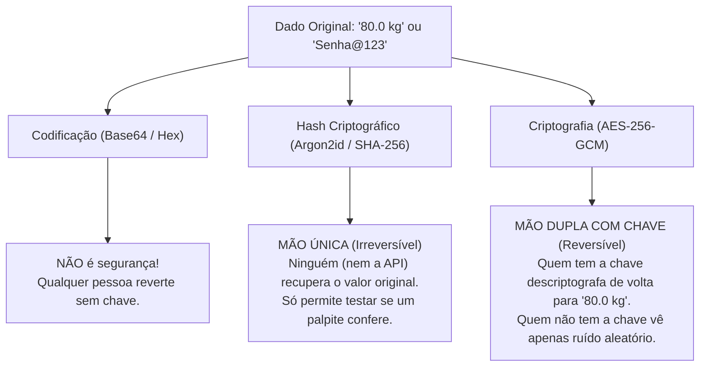

# Guia Didático Completo: Criptografia de Dados no Banco de Dados

> **Material de referência para aulas, palestras, treinamentos de engenharia e demonstrações ao vivo usando o MedVault Crypto API.**

---

## 1. A Grande Confusão: Hash vs. Criptografia vs. Codificação

Antes de falar em *Salt*, *Pepper* ou *AES-GCM*, é essencial distinguir três conceitos que frequentemente são confundidos no dia a dia de desenvolvimento:



| Conceito | Direção | Precisa de Segredo? | Quando usar? | Exemplo neste Projeto |
| :--- | :---: | :---: | :--- | :--- |
| **Codificação** (*Base64*, *Hex*) | Mão dupla (pública) | ❌ Não | Apenas para transportar bytes binários como texto em JSON/SQL | Empacotar o nonce e o ciphertext em `v1$<b64>$<b64>` |
| **Hash de Senha** (*Argon2id*, *bcrypt*) | **Mão única** (irreversível) | ✅ Sim (Salt + Pepper) | Quando **ninguém** precisa ler o valor original de volta — apenas validar um login | Coluna `users.password_hash` |
| **MAC / Blind Index** (*HMAC-SHA256*) | **Mão única determinística** | ✅ Sim (Pepper) | Quando precisamos fazer `WHERE campo = valor` sem revelar o dado real | Colunas `cpf_blind_index`, `email_blind_index`, `blood_type_blind_index` |
| **Criptografia Autenticada (AEAD)** (*AES-256-GCM*) | **Mão dupla** (reversível com a chave) | ✅ Sim (Chave DEK + Nonce + AAD) | Quando a API **precisa ler e devolver** o dado (`80.0 kg`, `O+`, `Dipirona`), mas o banco não pode enxergá-lo | Todas as colunas `*_encrypted` |

> [!WARNING]
> **Por que "Hash + Salt + Pepper" sozinho NÃO serve para o peso (`80.0 kg`)?**
> Se você aplicar um Hash irreversível (como Argon2 ou SHA-256 com Salt aleatório) sobre `80.0 kg` e salvar no banco, quando o médico abrir o prontuário do paciente na tela, **a API será incapaz de reverter o hash para mostrar `80.0 kg`**. Por isso, para campos que precisam ser lidos de volta, usamos **Salt + Pepper para derivar uma Chave de Criptografia (via HKDF)** e criptografamos o dado com **AES-256-GCM**!

---

## 2. Glossário Visual com Analogias do Mundo Real

### 🧂 1. O que é **Salt** (Sal)?
* **Definição Técnica**: Um valor público, longo e criptograficamente aleatório gerado individualmente para cada usuário ou registro e salvo no próprio banco de dados.
* **Analogia**: Imagine que dois clientes pedem o mesmo prato ("Arroz com Feijão" = `80.0 kg`). O *Salt* é um tempero único sorteado para cada prato antes de fechá-lo. Mesmo que o prato base seja idêntico, a assinatura química final fica completamente diferente.
* **No Projeto**:
  * Nas senhas: O `Argon2id` gera automaticamente 16 bytes de Salt aleatório embutidos no hash (`$argon2id$v=19$m=19456,t=2,p=2$<SALT>$<HASH>`).
  * Nos dados do usuário/prontuário: A coluna `users.user_salt` guarda 32 bytes aleatórios exclusivos de cada usuário.

### 🌶️ 2. O que é **Pepper** (Pimenta)?
* **Definição Técnica**: Um segredo de alta entropia configurado **fora do banco de dados** (em variáveis de ambiente, Vault ou AWS KMS).
* **Analogia**: Se o banco de dados for roubado (ex: vazamento de um arquivo `.sql` de backup), o ladrão leva os cofres e os *Salts*, mas **não leva a Pimenta Secreta do Chef**, que fica trancada apenas na memória do servidor da API. Sem o *Pepper*, o backup do banco é inútil.
* **No Projeto**: Temos **3 Peppers independentes** (separação de domínio) em [`config.py`](../src/app/core/config.py):
  1. `APP_ENCRYPTION_PEPPER`: Usado para derivar as chaves de criptografia de campos.
  2. `APP_BLIND_INDEX_PEPPER`: Usado para gerar os índices de busca cega.
  3. `APP_PASSWORD_PEPPER`: Usado no pré-hash das senhas antes do Argon2id.

### 🔑 3. O que é **HKDF** (*HMAC-based Key Derivation Function*)?
* **Definição Técnica**: Algoritmo padrão (RFC 5869) que combina um segredo mestre (*Input Keying Material* = `APP_ENCRYPTION_PEPPER`) com um `user_salt` para gerar uma chave criptográfica exclusiva de 256 bits para cada usuário (**DEK — Data Encryption Key**).
* **Por que é genial?**:
  * Não precisamos armazenar a chave de criptografia do usuário no banco de dados!
  * O banco guarda apenas o `user_salt` (que sozinho não serve para nada).
  * A API guarda apenas o `APP_ENCRYPTION_PEPPER` (que é um só para toda a aplicação).
  * Quando a API precisa ler ou gravar dados da **Alice**, ela junta `Pepper + Salt da Alice` no `HKDF` e obtém em microssegundos a **Chave Exclusiva da Alice**. Para o **Bruno**, `Pepper + Salt do Bruno` gera uma **Chave Exclusiva do Bruno** totalmente diferente!

### 🎲 4. O que é **Nonce / IV** (*Number Used Once*)?
* **Definição Técnica**: Um número aleatório de 96 bits (12 bytes) gerado a cada operação de criptografia no `AES-256-GCM`.
* **Por que precisamos dele se cada usuário já tem sua própria chave HKDF?**:
  * Imagine que a própria Alice pesa `80.0 kg` hoje, emagrece, e mês que vem volta a pesar `80.0 kg` — ou que dois campos diferentes do mesmo usuário tenham o mesmo valor `"80.0"`.
  * Se não houvesse o *Nonce* aleatório por gravação, usar a mesma chave da Alice sobre o mesmo texto geraria o mesmo texto cifrado. Com o Nonce de 96 bits sorteado via `os.urandom(12)`, **até para o mesmo usuário o texto cifrado muda a cada gravação**!

### 🛡️ 5. O que é **AEAD** (`AES-256-GCM`) e **AAD** (*Associated Authenticated Data*)?
* **Definição Técnica**:
  * **AEAD (*Authenticated Encryption with Associated Data*)**: Além de esconder o conteúdo (confidencialidade), gera um selo de integridade de 128 bits (**Auth Tag**). Se um único bit do texto cifrado for alterado no banco, a descriptografia recusa o dado na hora.
  * **AAD (*Associated Authenticated Data*)**: Metadados de contexto (`user:{user_id}|field:{field_name}`) que são amarrados matematicamente ao selo de integridade daquele campo.
* **Analogia do Lacre Nominal**:
  * Imagine um envelope lacrado contendo `"80.0"`. Sem o AAD, um funcionário mal-intencionado do banco poderia copiar o envelope da coluna `peso` e colar na coluna `altura` do mesmo paciente (fazendo o paciente parecer ter `80 metros` de altura!).
  * Com o **AAD**, o lacre de cera do envelope é fundido junto com a frase `"Pertence ao Usuário X | Coluna: weight_kg"`. Se alguém tentar abrir esse envelope na coluna `height_m` ou na linha do `Usuário Y`, o lacre quebra (`InvalidTag`)!

### 🔍 6. O que é **Blind Index** (Índice Cego com `HMAC-SHA256`)?
* **O Problema da Busca**: Como o `AES-256-GCM` gera um texto cifrado diferente a cada vez, o banco de dados não consegue fazer `WHERE cpf_encrypted = '...'`.
* **A Solução**: Ao lado da coluna `cpf_encrypted`, criamos uma coluna `cpf_blind_index` que guarda:
  $$\text{HMAC-SHA256}(\text{APP\_BLIND\_INDEX\_PEPPER}, \text{"cpf:12345678901"})$$
* Quando alguém busca pelo CPF `123.456.789-01`, a API limpa a pontuação, calcula o mesmo `HMAC-SHA256` usando o Pepper e faz um `SELECT ... WHERE cpf_blind_index = 'a8f9...'` usando um índice B-Tree comum do PostgreSQL em $O(1)$!

---

## 3. Matriz de Modelo de Ameaças (Threat Model)

Esta tabela é excelente para mostrar em apresentações executivas ou técnicas **o que acontece em cada cenário de incidente de segurança**:

| Cenário de Ataque / Vazamento | O que o Atacante Obteve? | O Atacante consegue ler os Prontuários (`80 kg`, `O+`)? | O Atacante consegue descobrir que Alice e Bruno têm o mesmo peso? | O Atacante consegue quebrar as Senhas? | O Atacante consegue copiar dados de um usuário para outro? |
| :--- | :--- | :---: | :---: | :---: | :---: |
| **1. Vazamento de Backup SQL / SQL Injection de Leitura** | Dump completo das tabelas `users` e `medical_records` (incluindo `user_salt` e `*_blind_index`) | ❌ **NÃO** (Falta o `APP_ENCRYPTION_PEPPER` para derivar as chaves HKDF) | ❌ **NÃO** (Ciphertexts, chaves e nonces são 100% diferentes) | ❌ **NÃO** (Falta o `APP_PASSWORD_PEPPER` + proteção Argon2id) | N/A (Apenas leitura) |
| **2. DBA Malicioso com Acesso de Escrita ao Banco** | Acesso total `SELECT / UPDATE / INSERT` no PostgreSQL, mas sem acesso às variáveis de ambiente da API | ❌ **NÃO** | ❌ **NÃO** | ❌ **NÃO** | ❌ **BLOQUEADO** (O `AAD` e a chave `HKDF` lançam `InvalidTag` se trocar linhas ou colunas) |
| **3. Vazamento apenas do `.env` (sem acesso ao Banco)** | Os Peppers do servidor, mas nenhum `user_salt` nem textos cifrados | ❌ **NÃO** (Não possui os dados nem os `user_salt` do banco) | ❌ **NÃO** | ❌ **NÃO** | ❌ **NÃO** |

---

## 4. Roteiro Passo a Passo para Demonstração ao Vivo (5 a 10 minutos)

Use este roteiro quando for apresentar o projeto ao vivo para uma banca, equipe ou cliente:

### Passo 1: Mostrar a Prova no Terminal (1 minuto)
Execute:
```bash
bash scripts/demo-scenario.sh
```
* **O que destacar na tela**:
  1. Mostre no JSON impresso que `user_a` (Alice) e `user_b` (Bruno) têm `shared_plaintext_value: 80.0` no campo `weight_kg`.
  2. Aponte para `user_a_ciphertext` e `user_b_ciphertext`: são completamente diferentes!
  3. Aponte para `tamper_checks.all_attacks_blocked: true`: mostre os 3 ataques bloqueados em tempo real.

### Passo 2: Explorar pelo Swagger UI (3 minutos)
Suba o servidor (`bash scripts/dev.sh` ou `bash scripts/up.sh`) e abra `http://localhost:8000/docs`:
1. Execute **`POST /api/v1/demo/crypto-playground`**:
   * Envie `sample_plaintext: "80.0"` e clique em **Execute**.
   * Mostre que `user_1_simulation.ciphertext`, `user_2_simulation.ciphertext` e até `same_user_second_encryption.ciphertext` são todos diferentes, mas `decrypted_back` retorna `"80.0"` em todos!
2. Execute **`POST /api/v1/demo/seed-comparison`** e copie o `user_a_id`.
3. Cole o `user_a_id` em **`GET /api/v1/demo/inspect-user/{user_id}`**:
   * Mostre a anatomia interna de cada coluna: o `raw_database_value`, o `nonce_hex`, a `gcm_auth_tag_hex` e o `aad_context`.

### Passo 3: Demonstrar a Busca Cega em O(1) (2 minutos)
Ainda no Swagger UI:
1. Vá em **`GET /api/v1/users/search/by-cpf`** e digite `111.222.333-44` (com pontos e traço) ou `11122233344` (sem pontuação).
2. Mostre que a API encontrou instantaneamente a paciente Alice pelo `cpf_blind_index` e devolveu todos os dados descriptografados junto com o IMC calculado (`bmi: 26.12`).
3. Vá em **`GET /api/v1/medical-records/search/by-blood-type`** e filtre por `O+`: mostre que ele encontra todos os pacientes `O+` sem precisar descriptografar pacientes de outros tipos sanguíneos!
