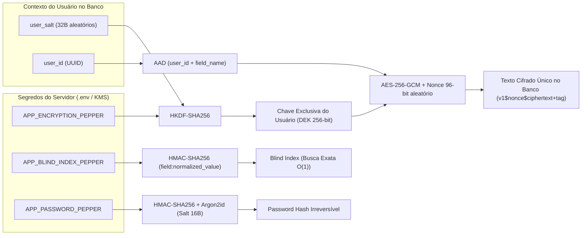

# One-Pager: MedVault Crypto API

> **Criptografia de Dados Sensíveis (PII & Prontuários Médicos) no Banco de Dados com Isolamento Criptográfico por Usuário**

---

## 1. O Problema

Em sistemas de saúde, finanças ou recursos humanos sujeitos à **LGPD** e **HIPAA**, salvar dados sensíveis em texto plano no banco de dados significa que qualquer vazamento de backup, SQL Injection ou acesso indevido de um administrador de banco (DBA) expõe imediatamente:
- Dados pessoais (**PII**): Nome, CPF, E-mail.
- Dados clínicos (**PHI**): Peso (`80.0 kg`), Altura (`1.75 m`), Tipo Sanguíneo (`O+`), Diagnósticos (`Hipertensão`) e Alergias (`Dipirona`).

Além disso, duas armadilhas comuns comprometem projetos que tentam proteger esses dados:
1. **Confundir Hash com Criptografia**: Aplicar *Hash + Salt + Pepper* (ex: Argon2/bcrypt) em campos como `peso = 80.0 kg` torna o dado **irreversível** — a API nunca mais consegue ler e devolver `80.0 kg` para o médico ou paciente.
2. **Criptografia Determinística ou Chave Única sem Nonce/Contexto**: Criptografar de forma determinística faz com que todos os pacientes que pesam `80.0 kg` ou têm sangue `O+` possuam **o mesmo texto cifrado** no banco, permitindo ataques de análise de frequência e correlação.

---

## 2. A Solução (Arquitetura em 3 Pilares)

O **MedVault Crypto API** resolve o problema combinando três primitivas criptográficas modernas no nível da aplicação:

| Pilar | Onde é usado | Algoritmo | Por que resolve? |
| :--- | :--- | :--- | :--- |
| **1. Criptografia Autenticada por Usuário** | Peso (`80.0 kg`), Altura, Sangue, Alergias, Diagnósticos, Notas, Nome, CPF, E-mail | `HKDF-SHA256(Pepper + UserSalt)` + `AES-256-GCM` (`Nonce` 96b + `AAD`) | **Reversível pela API**, porém **100% diferente no banco** para cada usuário e a cada gravação. Impede cópia de dados entre usuários/colunas. |
| **2. Blind Index (Índice Cego)** | Busca exata por CPF, E-mail e Tipo Sanguíneo | `HMAC-SHA256(BlindIndexPepper, field:normalized)` | Permite `SELECT ... WHERE cpf_blind_index = ?` em **O(1)** usando índice B-Tree sem descriptografar a tabela inteira. |
| **3. Hash de Senha** | Senha de acesso do usuário | `HMAC-SHA256(PasswordPepper)` + `Argon2id` (`Salt` 16B) | **Irreversível** e resistente a GPUs/ASICs; mesmo que o banco vaze, o atacante não possui o Pepper do servidor. |

---

## 3. Prova Visual para Demonstração

A API inclui endpoints dedicados (`/api/v1/demo/*`) projetados para demonstrações ao vivo e integração com Front-end:
- **`POST /api/v1/demo/seed-comparison`**: Cria dois pacientes (*Alice* e *Bruno*) com **exatamente `80.0 kg`, `1.75 m`, tipo `O+`, mesmas alergias/diagnósticos e mesma senha**, retornando lado a lado como todos os valores no banco são completamente diferentes.
- **`GET /api/v1/demo/inspect-user/{user_id}`**: Mostra a radiografia de cada coluna (valor bruto no banco, nonce, tag GCM, AAD, salt e blind index vs valor descriptografado).
- **`POST /api/v1/demo/tamper-check`**: Simula um invasor copiando o texto cifrado de `80.0 kg` da Alice para o Bruno (ou para outra coluna) e prova o bloqueio imediato pela tag de autenticação AEAD (`InvalidTag`).
- **`POST /api/v1/demo/crypto-playground`**: Permite testar qualquer valor em tempo real.
