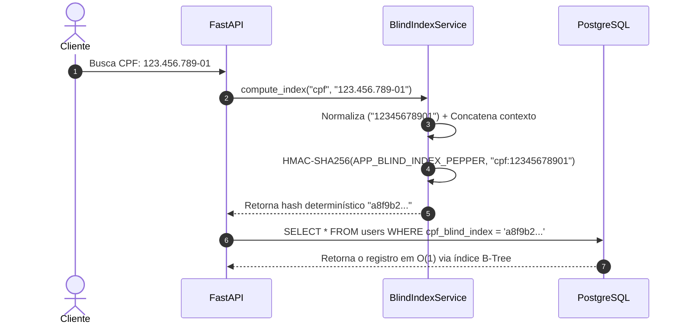

# 🔐 Criptografia de Dados no Banco de Dados
### Como Proteger PII e Prontuários Médicos sob LGPD e CFM

**MedVault Crypto API** • *FastAPI • SQLAlchemy 2.0 • AES-256-GCM • HKDF • Argon2id*

<div class="pt-8 text-sm opacity-80">
Pressione <kbd class="px-2 py-1 bg-gray-700 text-white rounded">Espaço</kbd> para avançar • Pressione <kbd class="px-2 py-1 bg-gray-700 text-white rounded">P</kbd> para Modo Apresentador
</div>

<!--
Notas do Apresentador:
- Boas-vindas a todos!
- Hoje vamos desmistificar a segurança de dados em repouso no banco de dados.
- O objetivo é resolver o dilema: como salvar dados sensíveis de modo que mesmo registros idênticos (como duas pessoas com peso 80.0 kg) fiquem 100% diferentes no banco, mas continuem descriptografáveis pela API e com busca rápida em O(1).
-->

---
layout: default
---

# 📌 O Problema Real: O que acontece se o Banco Vazar?

Imagine um banco de dados de saúde com **100.000 pacientes**:
- Muitos pacientes pesam exatamente **`80.0 kg`** ou medem **`1.75 m`**.
- Cerca de 40% da população possui tipo sanguíneo **`O+`**.
- Milhares possuem diagnóstico comum de **`Hipertensão`**.

<div class="grid grid-cols-2 gap-4 mt-6">

<div class="p-4 bg-red-950/40 border border-red-500 rounded-lg">
<h3 class="text-red-400 font-bold mb-2">1. Salvar em Texto Plano (Plaintext)</h3>
Qualquer vazamento de backup SQL (S3 esquecido, invasão de DBA, dump roubado) expõe todos os nomes, CPFs e prontuários imediatamente. Multas gravíssimas da LGPD e infração ética do CFM!
</div>

<div class="p-4 bg-amber-950/40 border border-amber-500 rounded-lg">
<h3 class="text-amber-400 font-bold mb-2">2. Criptografia Determinística Ingênua</h3>
Se você usar uma chave fixa sem Nonce, todo paciente com <code>80.0 kg</code> terá a mesma cifra <code>X9f2...</code>. Um invasor faz <strong>análise de frequência</strong> e descobre todos os diagnósticos por correlação estatística!
</div>

</div>

---
layout: default
---

# ❓ A Dúvida Clássica: "Hash + Salt + Pepper Resolve?"

Frequentemente ouvimos a sugestão: *"Vamos aplicar **Hash com Salt e Pepper** no peso e no diagnóstico!"*

<div class="mt-4">

| Pergunta Crucial | Hash + Salt + Pepper (`Argon2id`) | Criptografia Simétrica (`AES-256-GCM`) |
| :--- | :---: | :---: |
| **Dois valores iguais geram hashes diferentes?** | ✅ Sim | ✅ Sim |
| **Protege contra vazamento de backup?** | ✅ Sim | ✅ Sim |
| **A API consegue ler `80.0 kg` de volta?** | ❌ **NÃO! (Irreversível)** | ✅ **SIM! (Reversível com a Chave)** |

</div>

<v-click>

> 💡 **Conclusão de Arquitetura**:
> - **Senhas** usam **Hash Irreversível (`Argon2id`)**: Ninguém precisa ler a senha original de volta, apenas conferir no login.
> - **Dados Médicos e PII** precisam ser lidos pela API! Então usamos **Salt + Pepper para derivar uma Chave por Usuário (`HKDF`)** e ciframos com **`AES-256-GCM` probabilístico**.

</v-click>

---
layout: default
---

# 🏛️ A Arquitetura em 3 Pilares do MedVault

Cada necessidade de negócio exige uma ferramenta matemática diferente:

```mermaid
flowchart TB
    subgraph P1["PILAR 1: Criptografia de Campos (Reversível)"]
        KDF["HKDF-SHA256 (Pepper + user_salt)"] --> DEK["Chave DEK do Usuário (256-bit)"]
        DEK --> AES["AES-256-GCM + Nonce 96-bit + AAD"]
        AES --> R1["Peso, Altura, Diagnósticos, Nome, CPF"]
    end

    subgraph P2["PILAR 2: Busca Cega (Blind Index)"]
        HMAC["HMAC-SHA256 (Pepper de Busca, 'cpf:valor')"] --> BIDX["Índice Cego em O(1)"]
        BIDX --> R2["Busca exata por CPF, E-mail e Tipo Sanguíneo"]
    end

    subgraph P3["PILAR 3: Hash de Senha (Irreversível)"]
        ARGON["Argon2id + Salt 16B + Pepper de Senha"] --> PWD["Password Hash"]
        PWD --> R3["Autenticação de Acesso (/auth/login)"]
    end

    classDef p1 fill:#1E88E5,stroke:#0D47A1,color:#fff;
    classDef p2 fill:#00ACC1,stroke:#006064,color:#fff;
    classDef p3 fill:#8E24AA,stroke:#4A148C,color:#fff;

    class P1 p1;
    class P2 p2;
    class P3 p3;
```



---
layout: default
---

# 🧂 Salt vs. 🌶️ Pepper vs. 🎲 Nonce

Entenda a diferença essencial com analogias práticas:

<div class="grid grid-cols-3 gap-3 mt-6 text-sm">

<div class="p-3 bg-blue-950/40 border border-blue-500 rounded">
<h4 class="font-bold text-blue-400">🧂 Salt (Sal)</h4>
<p class="mt-1"><strong>Público por registro</strong>, salvo no próprio banco de dados (coluna <code>user_salt</code>).</p>
<p class="mt-2 text-xs opacity-80">Garante que a Alice e o Bruno nunca compartilhem a mesma chave DEK nem o mesmo hash de senha.</p>
</div>

<div class="p-3 bg-red-950/40 border border-red-500 rounded">
<h4 class="font-bold text-red-400">🌶️ Pepper (Pimenta)</h4>
<p class="mt-1"><strong>Segredo fora do banco</strong> (variável de ambiente, AWS KMS ou Vault).</p>
<p class="mt-2 text-xs opacity-80">Se um invasor roubar todo o backup SQL, ele tem os salts, mas não tem a pimenta! O backup vira lixo.</p>
</div>

<div class="p-3 bg-green-950/40 border border-green-500 rounded">
<h4 class="font-bold text-green-400">🎲 Nonce (Número Único)</h4>
<p class="mt-1"><strong>96 bits sorteados</strong> a cada gravação individual no AES-GCM.</p>
<p class="mt-2 text-xs opacity-80">Faz com que até o mesmo paciente pesando 80 kg hoje e 80 kg amanhã gere cifras 100% diferentes!</p>
</div>

</div>

---
layout: default
---

# 🔑 Pilar 1: Derivação de Chave por Usuário (`HKDF-SHA256`)

Não armazenamos nenhuma chave de usuário no banco! A chave é gerada na memória sob demanda:

```python {all|2-5|6-10|all}
def derive_user_key(self, user_salt: str) -> bytes:
    """Deriva uma chave DEK de 256 bits unindo Pepper do servidor + Salt do usuário."""
    salt_bytes = _b64url_decode(user_salt)
    
    hkdf = HKDF(
        algorithm=hashes.SHA256(),
        length=32, # 256 bits para o AES-GCM
        salt=salt_bytes,
        info=b"medvault-aes256gcm-user-dek-v1",
    )
    # A API combina o Pepper (em memória) com o Salt do usuário (do banco)
    return hkdf.derive(self._pepper_bytes)
```

<v-click>

- O banco guarda apenas o `user_salt` (que sozinho não serve para nada).
- O servidor guarda apenas o `APP_ENCRYPTION_PEPPER` (um segredo global no `.env`).
- **Alice** ganha a Chave DEK da Alice. **Bruno** ganha a Chave DEK do Bruno.

</v-click>

---
layout: default
---

# 🛡️ Pilar 1: O Escudo do AAD (*Associated Authenticated Data*)

Como impedir que um invasor com acesso SQL copie o peso da Alice e cole na linha do Bruno?

```python {all|3-4|5-6|all}
def encrypt_str(self, plaintext: str, *, user_id: str, user_salt: str, field_name: str) -> str:
    dek = self.derive_user_key(user_salt)
    # AAD: Amarração criptográfica de contexto
    aad = f"user:{user_id}|field:{field_name}".encode()
    nonce = os.urandom(12) # 96 bits aleatórios
    ciphertext = aesgcm.encrypt(nonce, plaintext.encode(), aad)
    return f"v1${_b64url_encode(nonce)}${_b64url_encode(ciphertext)}"
```

<div class="mt-4 p-3 bg-purple-950/40 border border-purple-500 rounded text-sm">
<strong>🚨 Tentativa de Ataque de Transplante:</strong><br/>
Se o invasor copiar o payload cifrado da coluna <code>weight_kg</code> e colar na coluna <code>height_m</code>, ou colar na conta de outro paciente, a descriptografia falha instantaneamente com <code>CryptoIntegrityError (InvalidTag)</code>!
</div>

---
layout: default
---

# 🔍 Pilar 2: Busca Exata em $O(1)$ via Blind Index

Como fazer `SELECT * FROM users WHERE cpf = ?` se o campo `cpf_encrypted` muda sempre?



- Zero vazamento de CPF no banco de dados.
- Performance máxima ($O(1)$) sem precisar descriptografar 100.000 linhas da tabela!

---
layout: default
---

# 🔬 A Prova Real no Banco de Dados

Dois pacientes cadastrados com os mesmos dados médicos: **`80.0 kg`**, **`1.75 m`** e sangue **`O+`**:

```
+-----------------------------------------------------------------------------------------+
|                                    VISÃO DO BANCO DE DADOS                              |
+----------+--------------------+---------------------------------------------------------+
| Paciente | user_salt          | weight_kg_encrypted (No PostgreSQL / SQLite)            |
+----------+--------------------+---------------------------------------------------------+
| Alice    | v1$8mK9pL2xQ1v...  | v1$r8mK9pL2xQ1vZ0wN$7fG3kP9mW2xL8qR4tY6uI1oP3aS5dF...  |
| Bruno    | v1$4mV6cX8zL0k...  | v1$bN4mV6cX8zL0kJ2h$1qW3eR5tY7uI9oP0aS2dF4gH6jK8lZ...  |
+----------+--------------------+---------------------------------------------------------+
```

<v-clicks>

- **100% Diferentes**: Nenhum invasor consegue deduzir que ambos pesam 80 kg.
- **Descriptografáveis**: A API autorizada devolve `80.0` para o médico em microssegundos.
- **Imunes a Adulteração**: Alterar 1 único bit quebra o selo de autenticidade (Auth Tag GCM).

</v-clicks>

---
layout: default
---

# ⚖️ Conformidade e Normas Atendidas

Nossa implementação atende diretamente as exigências legais e normas técnicas:

<div class="grid grid-cols-2 gap-4 mt-6 text-sm">

<div class="p-3 bg-gray-800 rounded border border-gray-600">
<h4 class="font-bold text-green-400">Normas Legais e Médicas</h4>
<ul class="mt-2 space-y-1">
<li><strong>LGPD (Art. 46 e 48)</strong>: Medidas técnicas aptas a proteger dados sensíveis.</li>
<li><strong>Resolução CFM 1.821 / SBIS</strong>: Confidencialidade e integridade em repouso.</li>
<li><strong>HIPAA (EUA)</strong>: Safe Harbor para dados médicos cifrados.</li>
</ul>
</div>

<div class="p-3 bg-gray-800 rounded border border-gray-600">
<h4 class="font-bold text-blue-400">Padrões Criptográficos (NIST / RFC)</h4>
<ul class="mt-2 space-y-1">
<li><strong>AES-256</strong>: NIST FIPS 197</li>
<li><strong>Modo GCM + AAD</strong>: NIST SP 800-38D</li>
<li><strong>HKDF-SHA256</strong>: RFC 5869</li>
<li><strong>Argon2id</strong>: RFC 9106</li>
</ul>
</div>

</div>

---
layout: center
class: text-center
---

# 🚀 Conclusão e Próximos Passos

O MedVault demonstra que **privacidade e performance** podem caminhar juntas na engenharia moderna.

<div class="mt-6 flex justify-center gap-4">
<a href="http://127.0.0.1:8000/docs" class="px-4 py-2 bg-blue-600 text-white rounded font-bold">Acessar Swagger Demo</a>
<a href="../guia-didatico-criptografia.md" class="px-4 py-2 bg-gray-700 text-white rounded font-bold">Ler Guia Completo</a>
</div>
