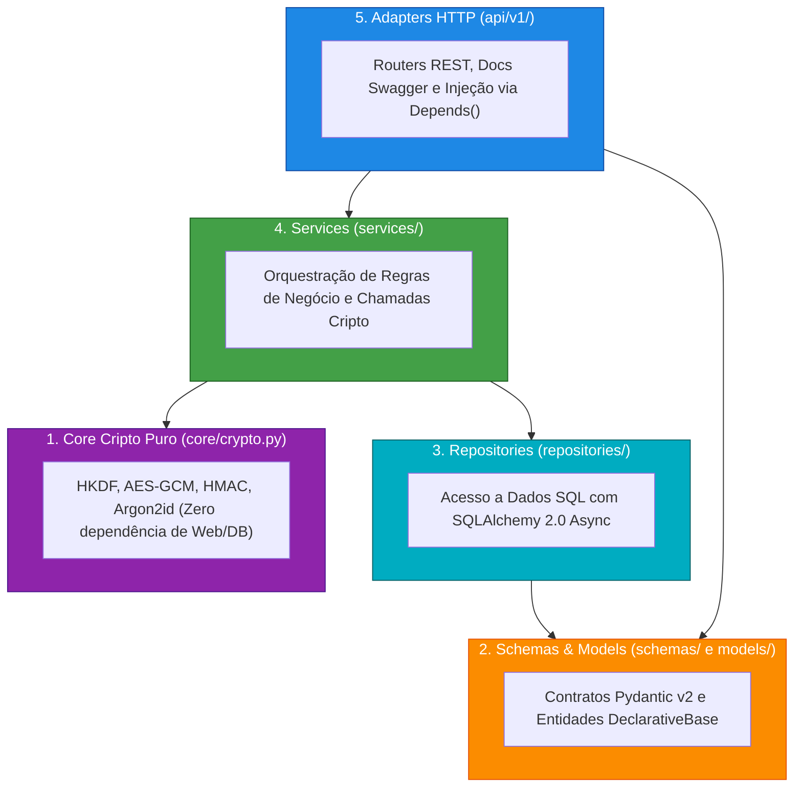
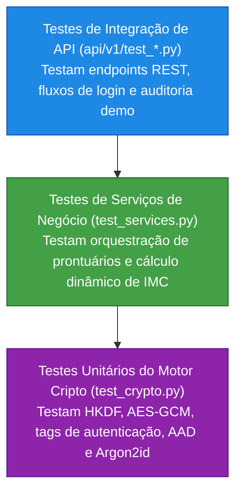

# 🏛️ Arquitetura e Clean Code
### Como Projetar um Backend Moderno com FastAPI, SQLAlchemy 2.0 e SOLID

**MedVault Crypto API** • *Clean Architecture • SOLID • KISS • DRY • Design Patterns*

<div class="pt-8 text-sm opacity-80">
Pressione <kbd class="px-2 py-1 bg-gray-700 text-white rounded">Espaço</kbd> para avançar • Pressione <kbd class="px-2 py-1 bg-gray-700 text-white rounded">P</kbd> para Modo Apresentador
</div>

<!--
Notas do Apresentador:
- Olá a todos!
- Neste segundo módulo, nosso foco é 100% em Engenharia de Software e Arquitetura Limpa.
- Vamos ver como organizar uma aplicação profissional em Python usando FastAPI, SQLAlchemy 2.0 Async, Pydantic v2 e os princípios SOLID aplicados na prática.
-->

---
layout: default
---

# 🎯 O Objetivo Arquitetural

Como construir uma aplicação robusta sem cair em dois extremos perigosos?

<div class="grid grid-cols-2 gap-6 mt-6">

<div class="p-4 bg-red-950/40 border border-red-500 rounded-lg">
<h3 class="text-red-400 font-bold mb-2">❌ O Código Espaguete</h3>
- Routers gigantescos com SQL cru misturado com regras de validação.
- Criptografia espalhada sem padrão.
- Impossível de testar sem subir um banco real.
</div>

<div class="p-4 bg-amber-950/40 border border-amber-500 rounded-lg">
<h3 class="text-amber-400 font-bold mb-2">❌ O Overengineering Extremo</h3>
- Dezenas de microserviços e mensagerias antes da hora.
- Interfaces vazias sem propósito real.
- Complexidade desnecessária violando o KISS.
</div>

</div>

<v-click>

> 💡 **A Solução Adotada**: **Clean Architecture Pragmática** dividida em camadas bem definidas e desacopladas, utilizando injeção de dependência nativa do FastAPI.

</v-click>

---
layout: default
---

# 🧅 As Camadas da Clean Architecture no MedVault

As dependências sempre apontam para dentro:



---
layout: default
---

# 🧩 SOLID no Código: SRP & OCP

Como aplicamos os dois primeiros princípios no MedVault:

<div class="grid grid-cols-2 gap-4 mt-4 text-sm">

<div class="p-3 bg-gray-800 rounded border border-gray-700">
<h4 class="font-bold text-blue-400">SRP (Single Responsibility)</h4>
<p class="mt-1">Uma classe deve ter um único motivo para mudar.</p>
<ul class="mt-2 text-xs space-y-1">
<li><code>PasswordCryptoService</code>: Cuida só de senhas (Argon2id).</li>
<li><code>BlindIndexService</code>: Cuida só de busca cega (HMAC).</li>
<li><code>FieldEncryptionService</code>: Cuida só de cifrar campos (AES-GCM).</li>
</ul>
</div>

<div class="p-3 bg-gray-800 rounded border border-gray-700">
<h4 class="font-bold text-green-400">OCP (Open/Closed Principle)</h4>
<p class="mt-1">Aberto para extensão, fechado para modificação.</p>
<ul class="mt-2 text-xs space-y-1">
<li>O envelope criptográfico possui versão explícita:</li>
<code class="text-xs bg-gray-900 p-1 rounded block mt-1">v1$nonce_b64$ciphertext_b64</code>
<li>Podemos criar <code>v2$</code> para algoritmos pós-quânticos sem alterar ou quebrar registros <code>v1$</code> antigos!</li>
</ul>
</div>

</div>

---
layout: default
---

# 💉 SOLID no Código: DIP (Inversão de Dependência)

Os controladores HTTP nunca instanciam dependências diretamente. Tudo é injetado via `Depends`:

```python {all|3-6|7-8|all}
@router.post("/users", response_model=UserResponse, status_code=201)
async def create_user(
    payload: UserCreate,
    user_service: UserService = Depends(get_user_service),
    _token: dict = Depends(require_admin_role),
):
    """O router apenas recebe a requisição e delega para o serviço injetado."""
    return await user_service.create_user(payload)
```

<v-click>

**Vantagens Imediatas**:
- **Testabilidade Total**: Nos testes de integração, podemos substituir `get_user_service` por um mock em 1 linha sem tocar no código de produção.
- **Desacoplamento**: O router não sabe de onde vêm os Peppers ou se o banco é SQLite ou PostgreSQL.

</v-click>

---
layout: default
---

# 🎨 Design Patterns: Facade & Factory

Dois padrões clássicos aplicados com elegância em Python:

```python {all|1-6|8-11|all}
# 1. FACADE PATTERN (crypto.py)
# Agrega os 3 serviços especializados em uma única interface limpa:
@dataclass(frozen=True)
class CryptoSuite:
    passwords: PasswordCryptoService
    blind_index: BlindIndexService
    fields: FieldEncryptionService

# 2. APPLICATION FACTORY PATTERN (main.py)
# Cria e configura a aplicação FastAPI isolada:
def create_app() -> FastAPI:
    application = FastAPI(title="MedVault Crypto API", lifespan=lifespan)
    application.include_router(api_v1_router)
    return application
```

---
layout: default
---

# ✨ Princípios DRY, KISS e Clean Code

<div class="grid grid-cols-3 gap-3 mt-6 text-sm">

<div class="p-3 bg-blue-950/40 border border-blue-500 rounded">
<h4 class="font-bold text-blue-400">DRY (Don't Repeat)</h4>
<p class="mt-2 text-xs opacity-90">
- Codificação Base64 URL-safe com padding em funções únicas centralizadas.<br/>
- Normalização de campos de busca unificada no Blind Index.
</p>
</div>

<div class="p-3 bg-green-950/40 border border-green-500 rounded">
<h4 class="font-bold text-green-400">KISS (Keep It Simple)</h4>
<p class="mt-2 text-xs opacity-90">
- SQLite padrão para rodar a demo sem instalar Docker.<br/>
- Sem frameworks complexos de mensageria onde uma chamada assíncrona basta.
</p>
</div>

<div class="p-3 bg-purple-950/40 border border-purple-500 rounded">
<h4 class="font-bold text-purple-400">Clean Code</h4>
<p class="mt-2 text-xs opacity-90">
- Tipagem estrita com Python 3.11+.<br/>
- Imutabilidade em estruturas de auditoria (<code>frozen=True</code>).<br/>
- Ruff configurado para garantir lint estrito e ordenação de imports.
</p>
</div>

</div>

---
layout: default
---

# 🧪 A Pirâmide de Testes no MedVault

Garantindo confiabilidade com **`pytest`** e SQLite assíncrono em memória:



> ⚡ **Execução Instantânea**: Os testes rodam em milissegundos sem depender de containers ou conexões de rede!

---
layout: center
class: text-center
---

# 🏁 Conclusão

Uma arquitetura limpa não é burocracia: é o que permite **evoluir a segurança do sistema** sem quebrar a aplicação!

<div class="mt-6 flex justify-center gap-4">
<a href="../arquitetura-engenharia-software.md" class="px-4 py-2 bg-blue-600 text-white rounded font-bold">Ler Documentação de Arquitetura</a>
<a href="../como-executar.md" class="px-4 py-2 bg-gray-700 text-white rounded font-bold">Guia de Execução</a>
</div>
